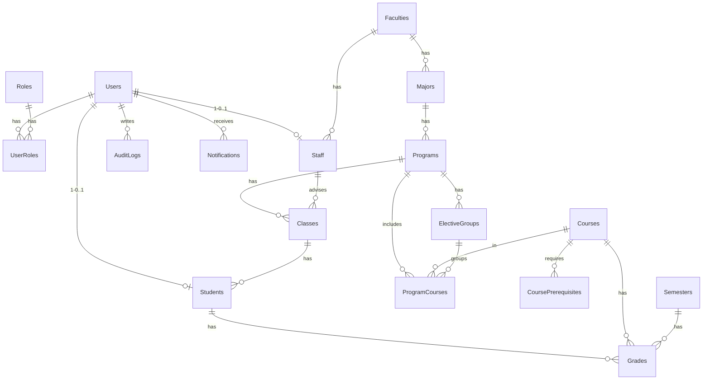

# Buổi 6 – Data Layer với EF Core (Đề tài 8 – SPTS)

## A. Phần nhóm

### 1. Cấu trúc
| Thành phần | File |
|---|---|
| Domain Models (18 entity) | `SPTS/Models/*.cs` |
| DbContext + Fluent API | `SPTS/Data/ApplicationDbContext.cs` |
| Connection string | `SPTS/appsettings.json` → `DefaultConnection` (LocalDB, DB `SPTS_DB`) |
| Đăng ký DbContext | `SPTS/Program.cs` → `AddDbContext<ApplicationDbContext>(o => o.UseSqlServer(...))` |
| Migration | `SPTS/Migrations/*_InitialCreate.cs` |
| Seed | `SPTS/Data/SeedData.cs` (chạy tự động khi khởi động nếu DB trống) |

Fluent API đã cấu hình:
- Khóa kép: `UserRoles(UserId, RoleId)`, `ProgramCourses(ProgramId, CourseId)`, `CoursePrerequisites(CourseId, PrerequisiteId)`.
- Unique: Username, Email, RoleName, CourseCode, ProgramCode, ClassCode, StudentCode, Students.UserId, Staff.UserId, Grades(StudentId, CourseId, SemesterId).
- Decimal: điểm `DECIMAL(3,1)`, thang 4 `DECIMAL(2,1)`; check constraint TotalScore trong khoảng 0–10.
- Mọi khóa ngoại `ON DELETE NO ACTION` (Restrict): không xóa dây chuyền, dùng xóa mềm (IsActive / IsDeleted).
- Entity CTĐT đặt tên `TrainingProgram` (bảng `Programs`) để tránh trùng lớp `Program` của Program.cs.

### 2. Lệnh tạo database
Package Manager Console (Visual Studio):
```
Add-Migration InitialCreate
Update-Database
```
Hoặc CLI (trong thư mục SPTS):
```
dotnet ef migrations add InitialCreate
dotnet ef database update
```
Minh chứng cần chụp: SQL Server Object Explorer → `(localdb)\MSSQLLocalDB` → `SPTS_DB` → Tables (19 bảng gồm `__EFMigrationsHistory`); thư mục `Migrations`.

### 3. Dữ liệu mẫu (SeedData)
| Tài khoản | Mật khẩu | Vai trò |
|---|---|---|
| admin | Admin@123 | Admin |
| giaovu | Staff@123 | Staff |
| sv2310001, sv2310002, sv2310003 | Student@123 | Student |

Ngoài ra còn có: 1 khoa, 1 ngành, 1 CTĐT (130 TC), lớp 23A1, 6 học phần (có tiên quyết, 1 nhóm tự chọn), 2 học kỳ, 8 mức thang điểm, 8 bản ghi điểm (có 1 môn trượt). Mật khẩu được băm bằng `PasswordHasher<User>` (PBKDF2).

### 4. ERD


## B. Phần cá nhân TV1 – Đoàn Phan Anh (Users, Roles, UserRoles, AuditLogs)

### 1. CRUD Users (`Areas/Admin/Controllers/UsersController.cs`)
| Action | Route | Ghi chú |
|---|---|---|
| Index | GET /Admin/Users | Tìm kiếm, lọc vai trò/trạng thái, sắp xếp, phân trang |
| Details | GET /Admin/Users/Details/{id} | Không hiện PasswordHash |
| Create | GET/POST /Admin/Users/Create | Dùng `UserEditModel`, băm mật khẩu, gán vai trò qua UserRoles |
| Edit | GET/POST /Admin/Users/Edit/{id} | Đổi thông tin, đồng bộ vai trò, để trống mật khẩu nghĩa là giữ nguyên (nhập mới = đặt lại) |
| Delete | GET/POST /Admin/Users/Delete/{id} | **Khóa** (IsActive = false), không xóa cứng; không khóa được Admin cuối cùng |
| Unlock | POST /Admin/Users/Unlock/{id} | Mở khóa, reset FailedLoginCount / LockoutEnd |

Mọi thao tác ghi đều ghi nhật ký qua `AuditLogService` (CREATE / UPDATE / LOCK / UNLOCK; giá trị cũ/mới lưu dạng JSON, không chứa mật khẩu). Mọi POST có `[ValidateAntiForgeryToken]`.

### 2. Query Pipeline
Users/Index:
```csharp
var query = _db.Users.AsNoTracking();
query = query.Where(u => u.Username.Contains(k) || u.FullName.Contains(k) || u.Email.Contains(k)); // tìm kiếm
query = query.OrderBy(u => u.FullName) / OrderByDescending(u => u.CreatedAt) ...;                  // sắp xếp
var total = await query.CountAsync();
var items = await query.Skip((page - 1) * size).Take(size).Select(u => new UserListItemViewModel {...}).ToListAsync(); // phân trang
```
SQL sinh ra (rút gọn):
```sql
SELECT ... FROM Users u WHERE u.Username LIKE N'%sv%' OR ... ORDER BY u.FullName
OFFSET @p ROWS FETCH NEXT @size ROWS ONLY
```
AuditLogs/Index: `Where(CreatedAt trong [From, To])` (tối đa 90 ngày) → lọc Action / TableName / Username → `OrderByDescending(CreatedAt)` → `Skip/Take`. Trang chỉ đọc, không có action sửa/xóa.

### 3. Data flow của module
```
View (form GET Index: Keyword, RoleId, SortOrder, Page)
 → Model binding → UserFilterViewModel
 → UsersController.Index()
 → ApplicationDbContext.Users (DbSet<User>)
 → LINQ: AsNoTracking().Where().OrderBy().Skip().Take().Select()   (IQueryable, chưa chạy)
 → EF Core dịch sang SQL (ToListAsync / CountAsync mới thực thi)
 → SQL Server (SPTS_DB) trả kết quả
 → EF materialize thành UserListItemViewModel → PagedResult
 → Controller trả View(model) → Razor render bảng + phân trang (_Pager)
```
Luồng ghi (Create/Edit/Delete): Form POST + AntiForgery token → UserEditModel → validate (DataAnnotation + kiểm tra unique) → thay đổi entity được DbContext theo dõi (Change Tracker) → `SaveChangesAsync()` sinh INSERT/UPDATE → `AuditLogService` ghi một dòng AuditLogs.

### 4. Lý thuyết
1. **EF Core là gì?** ORM (Object-Relational Mapper) mã nguồn mở của Microsoft cho .NET. Nó ánh xạ lớp C# với bảng CSDL, cho phép truy vấn bằng LINQ thay vì viết SQL tay, và hỗ trợ nhiều CSDL qua provider (SQL Server, SQLite, PostgreSQL…).
2. **DbContext có vai trò gì?** Là phiên làm việc với CSDL: quản lý kết nối, khai báo các `DbSet<T>` tương ứng với bảng, cấu hình mô hình (OnModelCreating), theo dõi thay đổi của entity (Change Tracker), và gom các thay đổi thành một transaction khi gọi `SaveChanges()`. Đăng ký DI dạng Scoped (mỗi request một instance).
3. **Migration dùng để làm gì?** Quản lý phiên bản lược đồ CSDL theo code (Code First). Mỗi lần đổi model, tạo migration mới để sinh lệnh tạo/sửa bảng (Up/Down). `Update-Database` áp dụng các migration vào DB, lịch sử lưu ở bảng `__EFMigrationsHistory`. Nhờ đó cả nhóm có cùng cấu trúc DB và có thể quay lui.
4. **Vì sao nên dùng async?** Truy vấn DB là thao tác I/O. Khi dùng `ToListAsync`/`SaveChangesAsync`, luồng xử lý được trả về thread pool trong lúc chờ DB, nên server phục vụ được nhiều request đồng thời hơn, không bị nghẽn thread khi tải cao.
5. **Khi nào dùng AsNoTracking()?** Khi chỉ đọc dữ liệu để hiển thị, không sửa rồi lưu lại (danh sách, chi tiết, báo cáo, nhật ký). EF bỏ qua Change Tracker nên nhanh hơn và tốn ít bộ nhớ hơn. Không dùng khi cần sửa entity rồi gọi `SaveChanges()` (như Edit POST, Delete POST).
